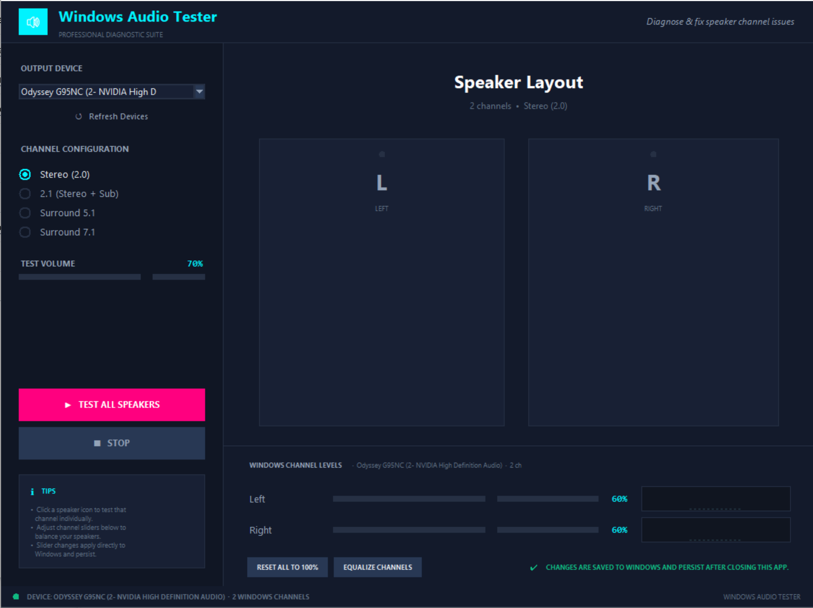

<p align="center">
  
</p>

<h1 align="center">Windows Audio Tester</h1>

<p align="center">
  <strong>Diagnose &amp; fix speaker channel issues on Windows — with a single Python file.</strong><br>
  Test individual speakers, adjust per-channel Windows volume, and see live output levels<br>in a neon-themed diagnostic interface.
</p>

<p align="center">
  <a href="#installation">Install</a>&nbsp;&nbsp;·&nbsp;&nbsp;<a href="#usage">Usage</a>&nbsp;&nbsp;·&nbsp;&nbsp;<a href="#features">Features</a>&nbsp;&nbsp;·&nbsp;&nbsp;<a href="#diagnosing-common-problems">Troubleshooting</a>
</p>

---

## Features

- **Per-channel speaker testing** — click any speaker button to play a frequency sweep through that channel only, with pulsing neon animation while active
- **Sequential sweep** — "Test All Speakers" cycles through every channel in order with synchronized visual highlighting
- **Windows channel level control** — per-channel volume sliders that write directly to the Windows Core Audio API — changes persist after closing the app
- **Live output visualizer** — animated frequency-bar meters per channel show real-time audio output levels
- **Multiple channel configurations** — Stereo 2.0, 2.1, Surround 5.1, and Surround 7.1
- **Device switching** — enumerate all Windows output devices and test any of them on the fly
- **Equalize & reset** — one-click buttons to equalize all channels or reset them to 100%
- **Single file, no build step** — just `python audio_tester.py`

---

## Installation

### 1. Install Python

Download from [python.org](https://www.python.org/downloads/) or the Microsoft Store (3.10+). Make sure **"Add Python to PATH"** is checked.

### 2. Install dependencies

```bash
pip install sounddevice numpy pycaw
```

> `pycaw` is optional but recommended — it enables the per-channel Windows volume sliders and live output meters. Without it, speaker testing still works.

### 3. Clone and run

```bash
git clone https://github.com/trezero/winAudioTest.git
cd winAudioTest
python audio_tester.py
```

---

## Requirements

| Dependency | Version | Purpose |
|---|---|---|
| **Python** | 3.10+ | Runtime |
| **sounddevice** | 0.5+ | Audio playback via PortAudio |
| **numpy** | 1.24+ | Tone generation |
| **pycaw** | any | Windows Core Audio control (optional) |
| **tkinter** | built-in | GUI (ships with Python) |

---

## Usage

```bash
python audio_tester.py
```

1. **Select an output device** from the dropdown. The app auto-selects your Windows default. Hit **Refresh Devices** if you plug something in.

2. **Choose a channel configuration** that matches your speaker setup:
   - **Stereo (2.0)** — headphones or left/right speakers
   - **2.1** — stereo + subwoofer
   - **5.1 / 7.1** — full surround setups

3. **Click a speaker button** to test that channel. The button pulses neon blue and you'll hear a 1.5s frequency sweep (200–1000 Hz) on that channel only.

4. **Test All Speakers** sweeps through every channel in sequence (0.6s each) with synchronized button highlighting.

5. **Adjust channel levels** using the Windows Channel Levels sliders at the bottom. These write directly to the Windows audio engine — changes are permanent and survive app restarts and reboots.

6. **Equalize** or **Reset** channels with the utility buttons if levels are imbalanced.

---

## Diagnosing Common Problems

### Only hearing sound from one speaker

1. Select **Stereo (2.0)** and test **Left** then **Right** individually.
2. Check the **Windows Channel Levels** sliders — if one is lower, drag it up.
3. If a channel is still silent: check physical cables, Windows Sound settings (Levels tab), and try a different output device.

### Surround speakers not working

1. Right-click the volume icon → *Sound settings → Device properties → Additional device properties → Configure* and select the correct speaker layout (5.1 / 7.1).
2. Return to this app and test each channel to pinpoint which speaker is missing.

### No sound at all

- Verify the correct device is selected (not a virtual/disabled device).
- Check that both the app volume slider and Windows system volume are above 0%.
- Look at the status bar for error messages.

### One speaker is quieter

This is exactly what the app is built for:
1. Test each channel and compare the visualizer bar levels.
2. Use the **Windows Channel Levels** sliders to balance them.
3. Click **Equalize Channels** to match all channels to the loudest one.

---

## Project Structure

```
winAudioTest/
├── audio_tester.py   # entire application — single file
├── interface.png     # screenshot
├── LICENSE
└── README.md
```

### Architecture

| Component | Description |
|---|---|
| `WindowsAudioController` | Wraps pycaw for per-channel volume read/write and peak metering via Windows Core Audio |
| `NeonRadio` | Custom Canvas-based radio button with neon-blue animated indicator |
| `VisualizerBar` | Animated 12-bar frequency visualizer using Canvas |
| `SpeakerButton` | Glass-panel speaker button with LED dot, pulse animation, and hover glow |
| `AudioTesterApp` | Main Tk window — device enumeration, playback threading, UI state |
| `generate_sweep()` | Creates a linear frequency sweep on a single channel |
| `generate_all_channels()` | Concatenates short tones across all channels for sequential testing |

Audio is generated with **numpy** as float32 PCM and played via **sounddevice** on a background daemon thread so the UI stays responsive. A 50ms fade-in/fade-out window prevents audible clicks.

---

## Customisation

All colors are in the `C` dict at the top of `audio_tester.py`. Playback can be tuned with:

```python
SAMPLE_RATE = 44100       # Hz
TEST_DURATION = 1.5       # seconds per individual channel sweep
SWEEP_FREQS = (200, 1000) # Hz start/end for the frequency sweep
```

To add a channel config (e.g. quad 4.0), add an entry to `CHANNEL_CONFIGS` — the UI picks it up automatically.

---

## License

[MIT](LICENSE) — free to use, modify, and distribute.
